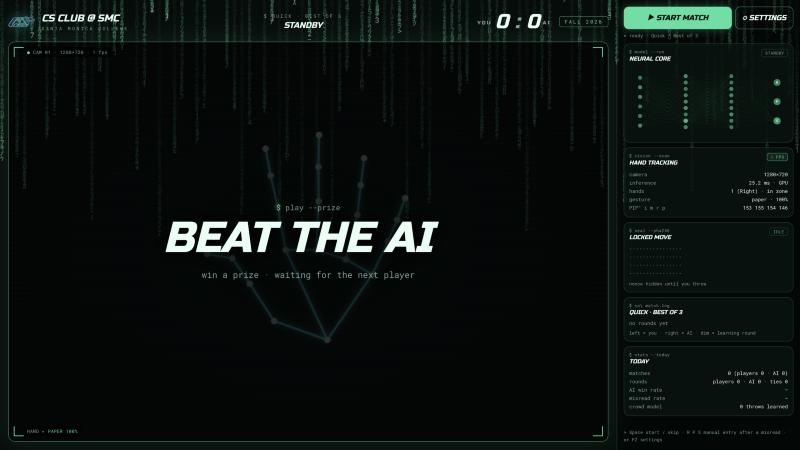

# Rock Paper Scissors AI

**Beat the AI, win a prize.** A booth game built for the [CS Club @ SMC](https://smccs.club) club day. Players throw rock, paper or scissors at a webcam, an AI opponent throws back, and a win means a prize.



Everything runs in the browser and works **offline**: hand tracking, the AI, sound effects and fonts are all bundled with the app.

## Features

- **Hand tracking in the browser.** [MediaPipe Hand Landmarker](https://ai.google.dev/edge/mediapipe/solutions/vision/hand_landmarker) finds 21 hand landmarks, and a small classifier turns the finger joint angles into rock / paper / scissors. The skeleton is drawn live over the camera feed.
- **Three match modes** (switchable from the on-screen Settings panel):
  | Mode | Rules |
  |---|---|
  | **Quick** | Best of 3, ties are replayed. Meant for a busy booth. |
  | **Series** | A fixed number of decisive rounds (7 to 13); most wins takes the match. |
  | **Learning + Final** | A set of learning rounds where the AI just watches, then a final round (or best of 3) played with what it learned. |
- **An opponent that adapts.** The AI predicts your next throw with a small adaptive model (a time-decayed, variable-order Markov-style predictor seeded with a "crowd" prior learned from everyone who played that day) and picks the best counter. Real people are much closer to random than any script, so expect it to be beatable.
- **Locked-in AI move.** The AI commits to its throw before the countdown and shows a SHA-256 hash of it; the move flips over at **SHOOT**.
- **Countdown with sound.** 3, 2, 1, SHOOT beeps plus result jingles, synthesized with the Web Audio API (no audio files). Can be switched off in Settings.
- **A terminal / `cmatrix` look.** Falling-character background, a live "neural core" animation (purely decorative), telemetry panels.
- **Staff controls.** Start / stop a match, switch modes, tune timing, pick the camera, and enter a throw by hand when a read fails.

## Quick start

You need **Node.js 20.9 or newer**, a webcam, and a modern browser (Chrome or Edge recommended).

```bash
git clone https://github.com/Yinghao-Guan/rps-ai.git
cd rps-ai
npm run start
```

Then open <http://localhost:3000> and allow camera access.

The first run installs dependencies and builds the app, so it needs an internet connection **once**; after that everything works offline. Run the commands from the repository root. There is nothing to `npm install` there, the launcher installs the frontend for you.

| Command | What it does |
|---|---|
| `npm run start` | Production mode (recommended for the real thing) |
| `npm run dev` | Development server with hot reload |
| `npm run build` | Build only |
| `npm run setup` | Install / verify dependencies only |

Set `PORT` to use a different port.

## Running a booth

1. The app starts on **standby** and ignores hands until a staff member clicks **START MATCH** in the side panel. One match = one visitor.
2. The visitor holds a hand in front of the camera. When it is steady, the countdown begins. They throw on **SHOOT**.
3. When the match ends the app returns to standby, ready for the next player.

| Key | Action |
|---|---|
| `Space` | Start a match / skip ahead |
| `R` `P` `S` | Enter rock / paper / scissors by hand after a misread |
| `` ` `` or `F2` | Open Settings |

Tips for a reliable read: keep the palm (or the back of the hand) facing the camera rather than pointing the fingers at the lens, use even lighting and a plain background, and keep other hands out of the frame. The side panel shows live finger angles and a misread rate to help you tune things on the day.

## Development

```bash
cd frontend
npm run lint
npm run test:logic        # game rules, AI and round-engine tests (needs Node 22.18+)
node node_modules/typescript/bin/tsc --noEmit
```

```
scripts/run.mjs            cross-platform launcher (install, build, start)
frontend/                  Next.js 16 app (App Router, TypeScript, Tailwind CSS v4)
  public/models/           MediaPipe hand landmarker model
  src/components/          UI: camera stage, side panel, settings, matrix rain, ...
  src/lib/game/            match rules (pure functions)
  src/lib/ai/              predictor, crowd prior, move selection
  src/lib/engine/          round state machine: standby > countdown > SHOOT > reveal > result
  src/lib/vision/          landmarks to rock / paper / scissors, MediaPipe wrapper
  src/lib/audio/           Web Audio sound effects
```

The game logic (`game`, `ai`, `engine`) is plain TypeScript with no browser dependencies, so it is tested directly in Node.

### Running from a portable drive

The project was made to be carried on an exFAT USB drive and run on macOS, Windows and Linux without changes. To make that work, the launcher reinstalls the (platform-specific) dependencies and clears the build cache whenever it notices it is on a different OS or path, and `frontend/.npmrc` disables `node_modules/.bin` links because exFAT has no symlinks. Package scripts therefore call tools as `node ./node_modules/<pkg>/...`.

## Credits and licenses

Code is released under the [MIT License](LICENSE).

- Hand tracking: [MediaPipe](https://github.com/google-ai-edge/mediapipe) (`@mediapipe/tasks-vision` and the bundled `hand_landmarker.task` model), Apache License 2.0.
- Fonts: [Russo One](https://fonts.google.com/specimen/Russo+One) and [Roboto Mono](https://fonts.google.com/specimen/Roboto+Mono), SIL Open Font License 1.1, bundled via [Fontsource](https://fontsource.org).
- Built with [Next.js](https://nextjs.org), [React](https://react.dev) and [Tailwind CSS](https://tailwindcss.com) (MIT).

The CS Club @ SMC name and logo (`frontend/public/brand/logo.png`) belong to the club and are not covered by the MIT License.
